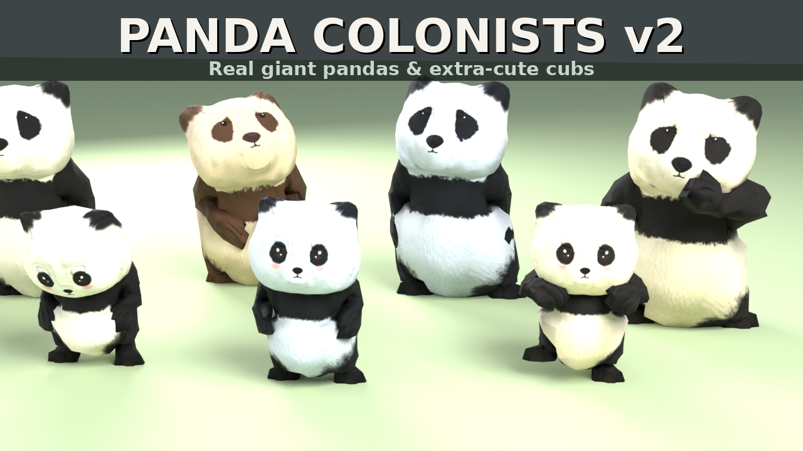

# Pandaborn - pandas for Timberborn

Every Folktail becomes a **giant panda** and every Iron Teeth beaver a **red panda**: chunky adults, chibi-cute kits,
and real see-through fur up close.

## Features
* **Panda bodies** for adults and kits: round heads and ears, chubby builds, puff tails. They run on **every original
  animation**, so every job, swim, zipline, dance and sleep works.
* **Two species, 5 adult and 3 kit coats each.**
  * Folktails are giant pandas: classic, cream, snowy, honey, and a rare brown *Qinling* panda.
  * Iron Teeth are red pandas: classic, deep chestnut, golden, soot-grimed, and a rare cinnamon.
* **Real shell + fin fur** on close-up pandas:
  * soft anti-aliased strands that stay plush even seen head-on
  * fuzzy strands along every outline
  * combed and clumped like a real coat
  * a dense undercoat, with shading from the panda's own shape
  * a soft sheen and backlit edges
  * follow-through when pandas move, and a little breeze sway
  * wet and badwater-matted fur
  * every panda's coat is slightly different
* **Portraits** for both factions (adults, kits, contaminated and new-game), rendered from the actual 3D models with real hair.
* **Any faction, any panda.** Folktails default to giant pandas and Iron Teeth to red pandas, but every faction can be
  set to either. That includes modded factions such as Emberpelts, Leaf Coats, Badfurs, Whitepaws and Deepfurs, which
  can also keep their own fur colours on the panda body. Pandaborn swaps each faction's textures and portraits at load,
  so faction mods need no special support.
* Outfits, hats, injuries, the selection highlight, wet fur, contamination and carried goods all still line up.
  The original beaver texture layout is kept.

## Install
1. Download `Pandaborn.zip` from [Releases](../../releases). It includes the large character models.
2. Unzip it into `Documents\Timberborn\Mods\`. You should end up with `Mods\Pandaborn\manifest.json`.
3. Enable **Pandaborn** in the game's mod manager.

The mod is purely visual, so it's safe to add to or remove from any save.

### Performance and settings
Fur is only drawn on the closest pandas (40 by default). It uses fewer layers at medium distance and fades out
completely when you zoom out, so a zoomed-out colony costs the same as an unmodded one.

With the **Mod Settings** mod (by eMka) installed, Pandaborn gets
an in-game settings page with these options:

* which animal each faction is (including every installed modded faction)
* fur on/off, quality, distance, max furry pandas and fur length
* fuzzy outlines and fur motion

Fur changes apply instantly. Faction changes apply to colonists created afterwards; reload the save to update everyone. Without it, Pandaborn works the same and reads `PandaFurSettings.txt`:

| setting | values |
|---|---|
| `folktails` / `ironteeth` / `otherfactions` | `giant` or `red` (modded factions also `own`); per faction: `faction.<Id> = ...` |
| `quality` | `low` / `medium` / `high` (default) / `ultra` |
| `enabled` | `false` turns the fur off (models and textures stay) |
| `motion` | `false` stops fur follow-through and sway |
| `fins` | `false` removes the outline strands |

## Repository layout
| path | contents |
|---|---|
| `mod/Pandaborn/` | The mod as installed, minus `Characters/Beaver/*.timbermesh`. Those files are 95 MB and 57 MB, too big for git, so they ship in Releases. |
| `src/scripts/` | C# runtime code: the fur renderer and mod starter (`PandaColonistsFur.cs`), the in-game settings page (`PandabornSettings.cs`, shipped as `Scripts/PandabornSettings.bin` and only loaded when Mod Settings is installed) |
| `src/unity/` | Fur shader, fur masks and the Unity editor build script. Drop this into the [official Timberborn modding project](https://github.com/mechanistry/timberborn-modding). |
| `src/pipeline/` | Python and Blender pipeline that turns the game's beaver models into pandas and paints the textures and portraits |
| `docs/` | Technical notes on the Timbermesh format, asset overrides, vertex animation and fur rendering |
| `tools/` | Build helpers |

## Building from source
* **Fur shader bundle:** use Unity **6000.5.11f1** (the game runs 6000.5.x).
  1. Open the official modding project.
  2. Copy `src/unity/Assets/Mods/PandaColonistsV6` into its `Assets/Mods/`.
  3. Run the menu *Panda Colonists > Build v6 Fur Bundle*.
  4. Copy the resulting `pandacolonistsv6_win` into `mod/Pandaborn/AssetBundles/`.
* **Scripts:** compile `src/scripts/*.cs` against the game's `Timberborn_Data/Managed` DLLs. See `tools/build_dlls.sh`.
* **Models, textures and portraits:** see [docs/PIPELINE.md](docs/PIPELINE.md). The pipeline needs files extracted
  from your own copy of Timberborn. No game files are included in this repository.

## Credits and AI disclosure
Made by JigglyPanda. Generative AI (Claude, by Anthropic) was used to write the modelling pipeline, shaders and code,
and to paint the textures procedurally. Portraits are 3D renders of the mod's own models, not AI-generated images.
Timberborn is © Mechanistry. This is an unofficial fan mod.
